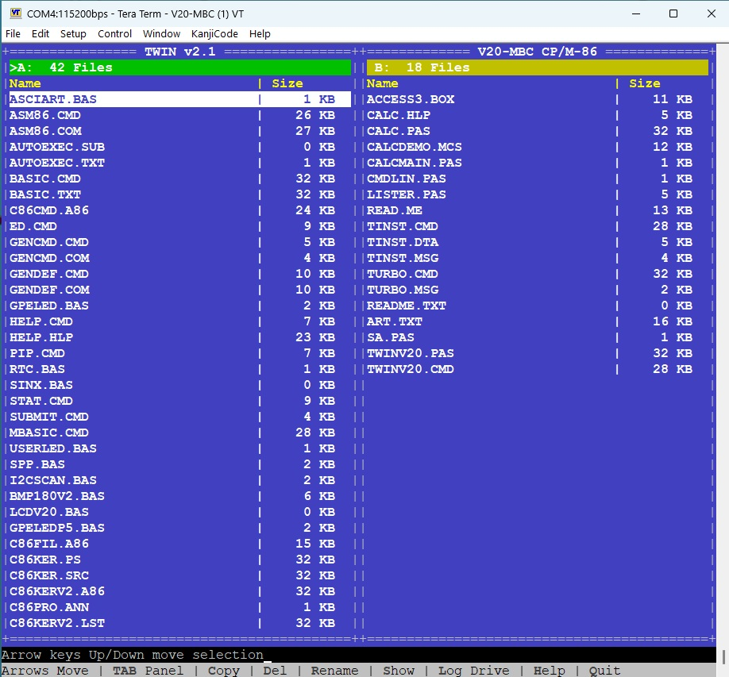
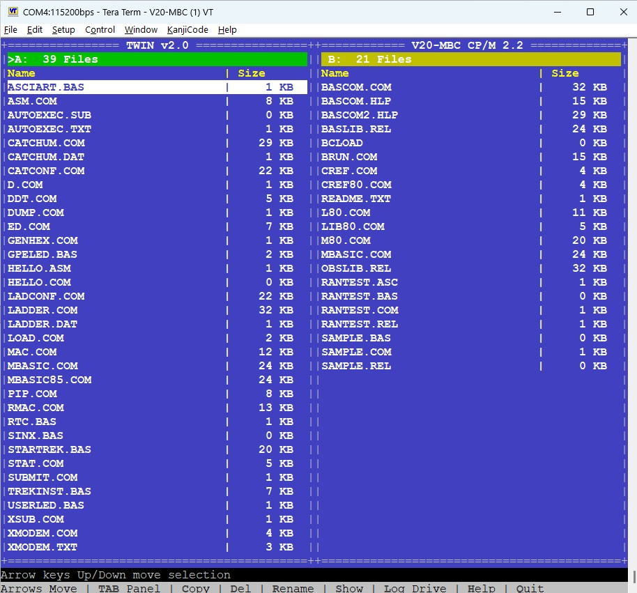
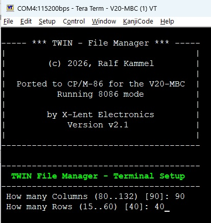
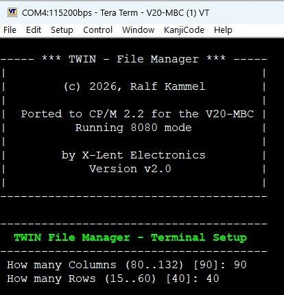
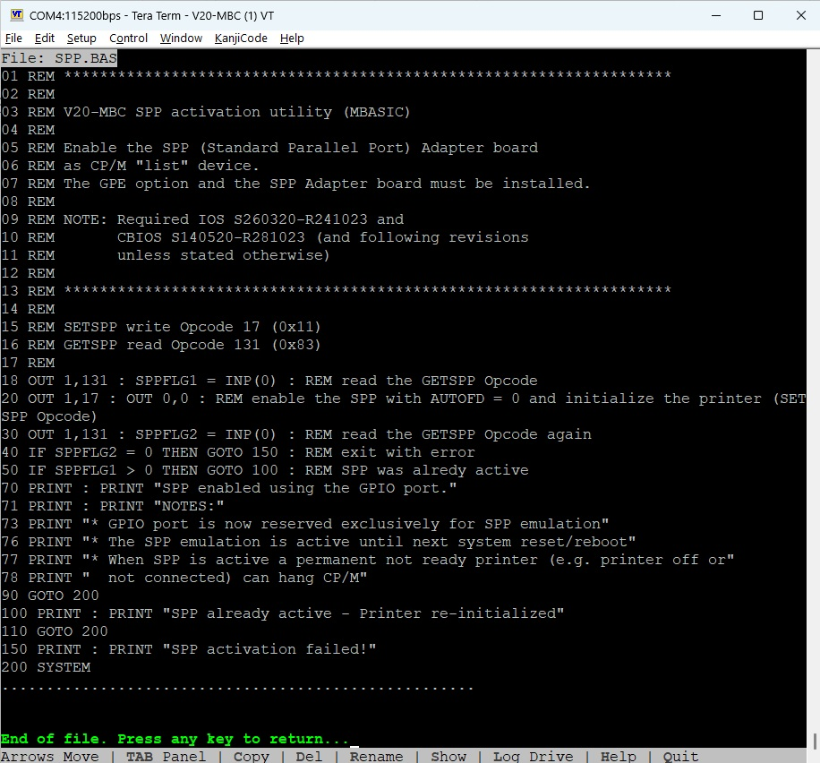
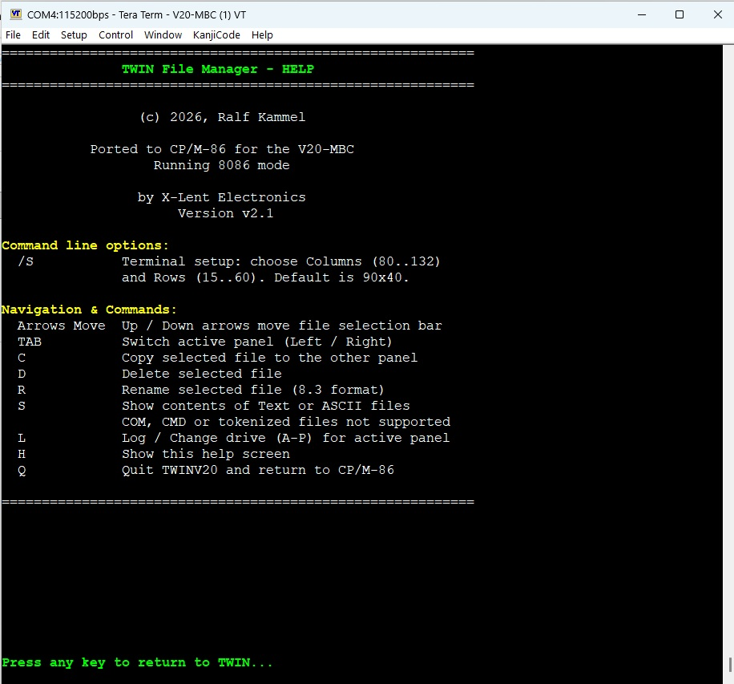
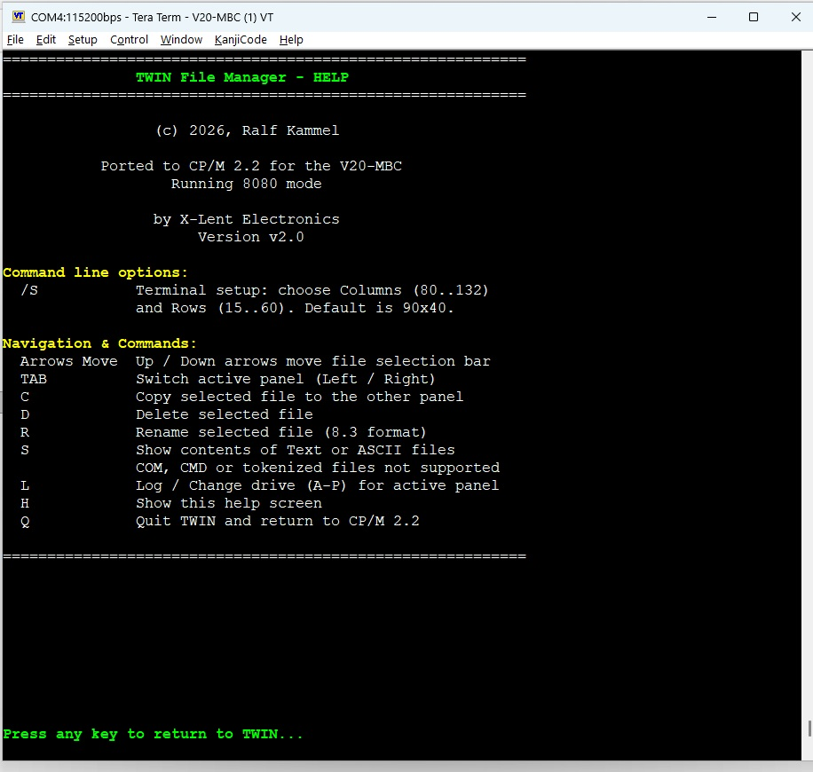

## TWINV20 & TWINC22 - V20-MBC File Manager for CP/M-86 v1.1 & CP/M v2.2

TWINV20.CMD and TWINC22.COM are a two-panel file manager for V20-MBC running CP/M-86 v1.1. and CP/M v2.2. Its layout and keyboard-driven workflow are inspired by the classic Norton Commander file manager.

## Remarks

The application TWINV20 is written in Borland Turbo Pascal 3.0B for CP/M-86 v1.1, V20-MBC running 8086 mode. The application TWINC22 is written in Digital Research Pascal/MT+ (80) v5.6.1 for CP/M v2.2, V20-MBC running 8080 mode. It uses a two-panel interface to browse drives and perform common file operations without leaving the program.

## Main screen

The screen is designed for Tera Term with terminal settings of 90 columns by 40 rows (90 x 40).
However, you can use the `/S` parameter at startup to specify different values ​​for the number of columns and rows.
TWINV20 and TWINC22 has been developed to provide an optimal view when using terminal settings of 80 x 24 up to 132 x 43.

- The left and right panels show the contents of two CP/M drives.
- At startup, the panels show drives A: and B:.
- The panel heading shows the drive letter and the number of files.
- File names appear on the left of each row. File sizes appear on the
  right, in KB rounded to whole numbers.
- The selected file is highlighted. The active panel is identified by
  an arrow in its heading.
- The command bar at the bottom lists the available keyboard commands.
- Status messages appear on the last line.

The panels use different heading colors to distinguish the active panel from the inactive one. The file lists use a blue background with bold white text, the selected name is shown in inverse video. The interface uses ANSI/VT escape sequences for colors and highlighting.

## Keyboard commands
 
- `Arrows Moves` :  Up / Down arrows moves the highlight files through the active panel's file list. The list scrolls when the selection reaches the visible panel edge.
- `TAB Panel` : Makes the other panel active.
- `Copy` : Copies the selected file to the same drive-independent filename on the other panel's drive.
- `Del` : Asks for confirmation, then deletes the selected file from the active drive. |
- `Rename` : Prompts for a new CP/M 8.3 filename, such as `NOTES.TXT`.
- `Show` : Opens the selected non-`.COM` file in the text viewer.
- `Log Drive` : Prompts for a drive letter from A: to P: and reloads the active panel. Press `ESC` to cancel.
- `Help` : Shows the HELP screen
- `Quit` : Leaves TWIN and returns to CP/M-86 or CP/M v2.2.

The arrow keys are read as ANSI/VT escape sequences.
Their behavior therefore depends on the terminal sending the expected cursor-key sequences.

## Usage

At start-up you can enter use the `/S` (or `/s`) switch, TWINV20.CMD /S or TWINC22.COM /S, to enter the terminal columns and rows.
By default the setting is 90 x 40.

## File lists

Each panel displays up to 240 file names. The file names use the CP/M 8.3 format, up to eight characters for the name and three for the extension, separated by a period.

The size shown for each file is calculated from its CP/M directory entries. When a file uses multiple extents, TWIN combines those entries into one row. Sizes are displayed in whole KB. Under CP/M 2.2, the directory records describe the file in 128-byte records, so the displayed size is an estimate rounded to KB. CP/M 3.0 also stores the byte count used in the final record.

TWINV20 uses a flat CP/M directory listing; it does not provide subdirectory navigation.

## Text viewer

Press `S` to display the selected file as text. `.COM`, `.CMD` or `tokenized` (like .`BAS`) files are not supported by the viewer. The viewer shows a page at a time and waits for a key when the screen is full. Press `Q` or `ESC` at the page prompt to leave the viewer. At the EOL of a file you have to press a key to return to TWINV20.

The viewer is intended for text files. Non-printing control characters may appear as dots or spaces.

## Help

When you type `H` the Help screen will open. In the Help screen the several switches and commands are explained.

## Requirements

### TWINV20.CMD
- V20-MBC
- CP/M-86 v1.1
- Borland Turbo Pascal 3.0B for CP/M-86 v1.1
- Tera Term or an 80 × 24 ANSI/VT-compatible terminal

Compile the program as a CMD file in Turbo Pascal

### TWINC22.COM
- V20-MBC
- CP/M v2.2
- Digital Research Pascal/MT+ (80) v5.6.1
- Tera Term or an 80 × 24 ANSI/VT-compatible terminal

The source code consist of 6 `.PAS` files. Due to the limitation of RAM in 8080 mode the files must not exceed 325 lines otherwise you may run in a compile error _Invalid opcode detected_. You have to compile every `.PAS` file and link everything together to create the COM file.

## Build Environment

No modern cross-compilers or emulators were used in the making of this binary. The source code is compiled natively on genuine vintage V20 CPU in 8086 or 8080 mode. An V20-MBC running the original Turbo Pascal 3.0B compiler to compile TWINV20.PAS or Digital Research Pascal/MT+ (80) v5.6.1 to compile the TW22xxx.PAS files.

### MTPLUS Compiler

The content on the V20-MBC SD card does not by default include MTPLUS compiler from Digital Research Pascal/MT+ (80) v5.6.1. You must first copy MTPLUS to the SD card to be able to compile. The first empty drive on the SD card is F:, DS0N05.DSK.

## History

The original idea for a Norton Commander look a like file manager for CP/M is from Ralf Kammer, who developed TWIN for Z80 based CP/M systems, https://github.com/RalliKam.TWIN works well with CP/M-3 on the Z80-MBC2, but it did not work on the V20-MBC with CP/M-86 or CP/M v2.2. After the successful port to CP/M-86 v1.1 modifications and improvements were done. After that was done, the challenge was to have as well a TWIN version working on the V20-MBC in 8080 mode with CP/M- v2.2. The end result is here on GitHub.  The behavior of both TWIN file managers are exactly the same.

## License

This project is licensed under the [MIT License](LICENSE) - see the `LICENSE` file for details.

## Version

### TWINV20

Version v1.0 : Original TWIN for Z80 CP/M based systems.

Version v2.0 : TWINV20 By X-Lent Electronics, November 2026, for V20-MBC.
  - v1.0 Ported to CP/M-86 1.1 for the V20-MBC in 8086 mode
  - Start up screen showing Copyright info
  - Improved drawing of the panels
    No complete redraws of the panels by executing a Command   
  - Improved file selection wiht Up/down keys
    No redraws of the panels, just scrolls file up or down
  - Display name in Right penal renamed to V20-MBC 
  - Start up switch `/S` or `/s` option to enter terminal Columns and Rows
    Default setting is 90 x 40
  - Solved bug. When file name is 12 characters error cannot open file, which is wrong
    Now it opens file names of 12 charecters long correctly
  - `S Show`, you must press a key to return to TWIN when EOF is reached
    Time now to read the content
  - Added status message COM/CMD with tokenized files cannot be displayed
  - Added `H Help` procedure. Help screen in new window
  - Change Commandline look and feel
  - `/O` or `/o` to show date is not supported in CP/m-86 1.1
    A statusline messages is displayed when /O or /o is used 

Version v2.1 :
  - Removed /O or /o option. cannot be used in CP/M-86 v1.1.
  - Added Running 8086 in Startup and Help screen  

### TWINC22

Version v1.0 : Original TWIN for Z80 CP/M based systems.

Version 2.0 : TWINC22 By X-Lent Electronics, November 2026, for V20-MBC.
  - v2.0 ported to CP/M v2.2 for V20-MBC in8080 mode with all feature from TWINV20

